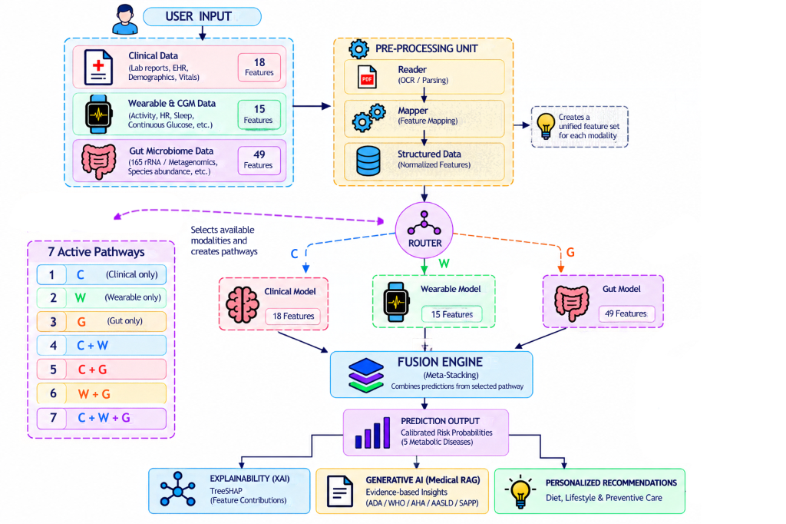

# TeleMed-M3: Dynamic Imputation-Free Multimodal Learning for Explainable Metabolic Disease Risk Stratification

[](https://www.python.org/)
[](https://tele-med-omega.vercel.app)
[-orange)](publication/)
[](LICENSE)
[](ai/datasets/)
[](ai/models/)
[](ai/explainability/)

This repository provides the official implementation, synthetic cohort generation pipelines, trained model payloads, and evaluation artifacts for the research paper:

> **TeleMed-M3: Dynamic Imputation-Free Multimodal Learning for Explainable Metabolic Disease Risk Stratification**  
> *Gunda Swaran, Kolipaka Vishal, Pagidipalli Sunny Kiran, Chikyala Medhansh Rao, Aitha Thadhagath Ram, and Dr. K. V. Rajini*  
> Department of Computer Science and Engineering, Keshav Memorial Institute of Technology, Hyderabad, India.  
> *Submitted to SN Computer Science (Springer Nature).*

---

## 🌐 Live Interactive Demonstration

An interactive clinical decision-support portal demonstrating the end-to-end TeleMed-M3 pipeline (Intelligent Data Intake $\rightarrow$ 7-Pathway Dynamic Routing $\rightarrow$ Stacking Meta-Learner $\rightarrow$ TreeSHAP Attributions $\rightarrow$ Grounded Clinical Reporting) is deployed live:

👉 **[Launch Live Web Platform (tele-med-omega.vercel.app)](https://tele-med-omega.vercel.app)**

### Demo Login Accounts for Reviewers & Evaluators:
| Role | Email | Password | Access Scope |
| :--- | :--- | :--- | :--- |
| **Patient** | `patient@telemed.ai` | `Password123!` | Multimodal intake, personalized metabolic risk scores, XAI explanations |
| **Doctor** | `doctor@telemed.ai` | `Password123!` | Patient review matrix, 7-pathway probability inspection, clinical reports |
| **Admin** | `admin@telemed.ai` | `Password123!` | System health, model telemetry, and ingestion governance |

> **Note for Evaluators:** The backend inference microservices are hosted on a cloud container with automatic idle sleeping. If the application has been idle, please allow **30–45 seconds for the initial cold-start** on your first request. Subsequent interactions run at sub-second latency.

---

## 🔬 Abstract Overview

Cardiometabolic diseases—Type 2 Diabetes (T2D), Prediabetes, High Adiposity Risk, Metabolic Syndrome, and Non-Alcoholic Fatty Liver Disease (NAFLD)—arise from complex interactions among clinical biomarkers, continuous behavioral patterns, and intestinal microbial ecology. While contemporary telehealth platforms capture laboratory results and wearable signals, gut microbiome data and robust strategies for handling incomplete modality coverage remain scarce.

**TeleMed-M3** introduces a modular multimodal learning framework for individualized metabolic risk stratification without numerical reconstruction of missing modalities. The architecture deploys fifteen modality-specific expert classifiers across Clinical (18 features), Wearable/CGM (15 features), and Gut Microbiome (49 features) blocks, then fuses their probability outputs through an L2-regularized logistic regression meta-learner trained on five-fold stratified out-of-fold predictions. A deterministic routing layer directs each patient through one of seven non-empty modality pathways ($2^3 - 1$ subsets), avoiding artificial imputation of unobserved channels.

<p align="center">
  
</p>

---

## 📁 Repository Structure

```text
TeleMed-M3/
├── README.md                           # Official Paper & Replication Guide
├── requirements.txt                    # Python runtime dependencies
├── LICENSE                             # MIT Open Source License
├── publication/                        # Full LaTeX manuscript, references & figures
│   ├── TeleMed_M3_Manuscript.pdf       # Compiled publication PDF
│   ├── TeleMed_M3_Overleaf_Submission.zip # Complete self-contained Overleaf archive
│   ├── manuscript.tex                  # Formatted LaTeX paper source
│   ├── references.bib                  # 34 peer-reviewed citations
│   └── figures/                        # High-resolution publication figures
├── ai/
│   ├── config/                         # Modality feature definitions & hyperparams
│   ├── models/                         # Trained expert model payloads & stackers
│   │   ├── clinical/                   # Clinical expert models (CatBoost, ROC-AUC 0.7777)
│   │   ├── wearable_cgm/               # Wearable/CGM models (CatBoost, ROC-AUC 0.6772)
│   │   ├── gut_microbiome/             # Gut microbiome models (LightGBM, ROC-AUC 0.6487)
│   │   └── fusion/                     # L2-regularized logistic regression stackers
│   ├── inference/
│   │   ├── v3_scientific_router.py     # 7-Pathway Dynamic Routing Engine
│   │   ├── fusion_inference.py         # Out-of-fold probability-level fusion
│   │   └── expert_inference.py         # Single-modality inference wrappers
│   ├── explainability/
│   │   └── unified_xai_engine.py       # Polynomial-time TreeSHAP feature attributions
│   └── datasets/
│       ├── generation/                 # De-clamped Gaussian Copula 100k cohort generator
│       │   ├── generate_multimodal_v4b_declamped.py
│       │   ├── clinical/               # 18 Clinical lab & anthropometric features
│       │   ├── wearable_cgm/           # 15 Wearable & CGM time-series features
│       │   └── gut_microbiome/         # 49 Gut microbiome taxa & diversity indices
│       └── final/                      # Train/Val/Test split IDs & Dataset Specifications
│           ├── train_ids_v4.csv        # 70,000 training partition IDs
│           ├── val_ids_v4.csv          # 15,000 validation partition IDs
│           ├── test_ids_v4.csv         # 15,000 held-out test partition IDs
│           └── V4_DATASET_SPECIFICATION.md
├── services/
│   ├── medical_rag/                    # Guideline-grounded clinical RAG (FAISS + LLM)
│   └── multimodal_intake/              # Schema validation & physiological boundaries
└── scripts/
    ├── test_reproducibility.py         # Clinical expert test-set verification
    └── test_fusion_reproducibility.py  # 7-Pathway stacker verification
```

---

## ⚡ Quickstart & Replication

### 1. Installation

```bash
git clone https://github.com/SWARANGUNDA/TeleMed-M3.git
cd TeleMed-M3
pip install -r requirements.txt
```

### 2. Verify 7-Pathway Dynamic Routing (Reproduce Table 1)

Execute the fusion reproducibility benchmark on the 15,000 held-out test partition:

```bash
python scripts/test_fusion_reproducibility.py
```

### 3. Generate the 100,000-Patient Synthetic Cohort

To regenerate the complete, privacy-preserving 100,000-record synthetic dataset from first principles:

```bash
python ai/datasets/generation/generate_multimodal_v4b_declamped.py
```

All marginal distributions, Spearman rank correlations, and clinical override boundaries are strictly preserved.

---

## 📊 Summary of Experimental Benchmarks

### Table 1: AUROC Across All Seven Availability Pathways (15,000 Test Cohort)

| Target Condition | C (Clinical) | W (Wearable) | G (Gut) | C+W | C+G | W+G | C+W+G (Full) |
| :--- | :---: | :---: | :---: | :---: | :---: | :---: | :---: |
| **Type 2 Diabetes** | 0.7777 | 0.6772 | 0.5949 | 0.7825 | 0.7788 | 0.6894 | **0.7834** |
| **Prediabetes** | 0.5839 | 0.5429 | 0.5134 | 0.5875 | 0.5840 | 0.5428 | **0.5875** |
| **High Adiposity Risk** | 0.7532 | 0.6602 | 0.5263 | 0.7547 | 0.7532 | 0.6607 | **0.7547** |
| **Metabolic Syndrome** | 0.7581 | 0.6207 | 0.5777 | 0.7586 | 0.7581 | 0.6336 | **0.7586** |
| **NAFLD** | 0.7743 | 0.5995 | 0.6487 | 0.7745 | 0.7771 | 0.6621 | **0.7772** |

*Note: For NAFLD, the Gut Microbiome expert significantly outperforms Wearables ($0.6487$ vs $0.5995$), accurately reflecting the biological gut-liver axis.*

### Table 3: Robustness under 30% Simulated Modality Missingness (MCAR)
* **Dynamic Routing:** Achieves **0.7743** AUROC on T2D.
* **Median Imputation Baseline:** Achieves **0.7722** AUROC on T2D.
* **Advantage:** Dynamic Routing avoids populating unobserved channels with uninformative medians, preserving predictive fidelity without numerical distortion.

---

## 🛡️ Clinical Safety & Scope

TeleMed-M3 is expressly designed as a **research-stage clinical decision-support framework (CDSS)** and is **not an autonomous diagnostic device**. All findings in this repository derive from in silico synthetic cohorts. Multi-center prospective validation on consented human cohorts is required prior to bedside deployment.

---

## 📖 Citation

If you use this codebase, synthetic generator, or methodology in your research, please cite:

```bibtex
@article{gunda2026telemedm3,
  title={TeleMed-M3: Dynamic Imputation-Free Multimodal Learning for Explainable Metabolic Disease Risk Stratification},
  author={Gunda, Swaran and Kolipaka, Vishal and Pagidipalli, Sunny Kiran and Chikyala, Medhansh Rao and Aitha, Thadhagath Ram and Rajini, K. V.},
  journal={SN Computer Science (Under Review)},
  year={2026}
}
```

---

## 📄 License
This project is licensed under the [MIT License](LICENSE).
